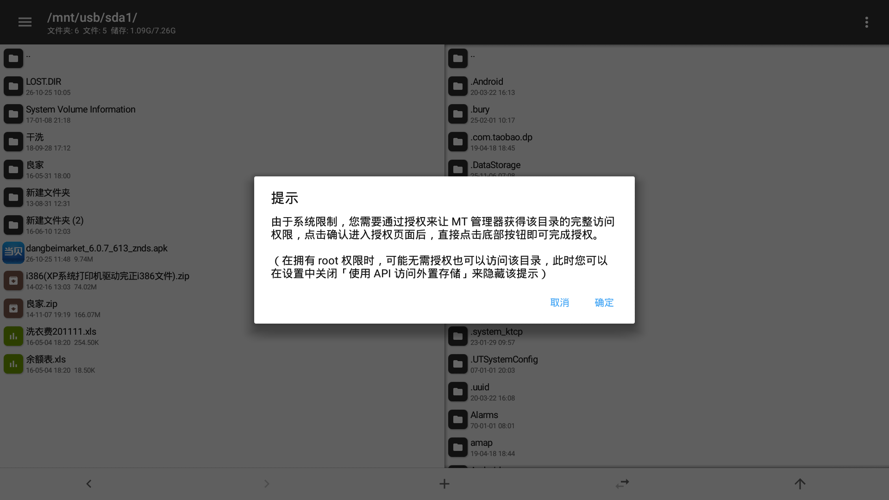

# 05 · 文件管理与 U 盘安装

> 适用：PPOS 7.x（本机 7.2.148PU / Android 5.0.1）。这一章解决"电视上没有文件管理器、U 盘插上去不知道从哪打开"的问题。

---

## 1. 为什么这机器需要单独一章

PPOS 没有独立的文件管理器 App，U 盘相关的入口全部挂在**电视管家**（`com.pptv.tvhousekeeper`）里：

- 插 U 盘后系统弹的提示由电视管家处理；
- "我的应用 / U 盘安装"入口是 `.myapp.MyAppActivity`；
- 一旦禁用电视管家，插 U 盘只会得到一句 **「您访问的内容找不到了」**（已实测）。

所以 [04-系统精简.md](04-系统精简.md) 的「三不禁」里，电视管家是保命项之一。

---

## 2. 系统侧的存储事实（实测）

```text
# /storage 下只有主存储，没有为 U 盘生成二级卷
/storage
└── emulated          dr-xr-xr-x root root

# 定制 vold 把 U 盘直接挂到 /mnt/usb/sda1
tmpfs        /mnt/usb        tmpfs rw,relatime,mode=755,gid=1000
/dev/block/vold/8:1 /mnt/usb/sda1 vfat rw,dirsync,nosuid,nodev,noexec,relatime,
                    uid=1023,gid=1023,fmask=0002,dmask=0002,allow_utime=0020,
                    codepage=437,iocharset=iso8859-1,shortname=mixed,utf8,errors=remount-ro
```

关键点：

- U 盘**不在** `/storage/` 下，`getExternalFilesDir` 之类 API 找不到它；
- 挂载点属主是 `media_rw`（uid/gid **1023**），目录权限 `775`；
- `/system/etc/permissions/platform.xml` 里共有 **4 处** `<group gid="media_rw" />`（存储类权限的组映射），
  所以**持有存储权限的第三方 App 实际能读写 `/mnt/usb/sda1`**（下面用 MT 管理器实测印证）；
- 但 `/storage` 没有二级卷，意味着依赖 `StorageVolume` 枚举的 App（很多"电视文件管理器"）
  在文件选择器里看不到 U 盘，得手动输入 `/mnt/usb/sda1` 这种路径。

---

## 3. MT 管理器实测（`bin.mt.plus`）

选它做验证是因为官方提供直接下载、支持 armv7 且 minSdk 足够低。

| 项 | 值 |
|---|---|
| 包名 / 版本 | `bin.mt.plus` / **2.26.10 (26101061)** |
| minSdk / targetSdk | **21** / 30 |
| 架构 | armeabi-v7a、arm64-v8a、x86、x86_64 全带 |
| 安装包 | 37,521,106 字节（官方 `pan.mt2.cn/apk/26101061`） |
| 安装后占用 | **42 MB**（`/data/app/bin.mt.plus-1/base.apk`） |

**能用的部分（已在本机 1920×1080 上逐项验证）**

- `adb install -r` 一次装成，启动正常，双栏文件管理界面渲染无错位；
- 默认进入 `/storage/emulated/0`，可正常浏览、进入子目录；
- **能直接读到 U 盘**：地址栏输入 `/mnt/usb/sda1` 后完整列出内容，
  并能进入 `新建文件夹 (2)` 等子目录（说明读权限确实随存储权限带上了）；
- 方向键（D-pad）在文件列表里可以移动选中高亮。



**不好用的部分**

- 它是**手机版界面**，没有 TV / leanback 适配：工具栏、按钮、弹窗都没有焦点框，
  遥控器只能滚动列表，点按钮基本要靠鼠标；首次启动的用户协议弹窗还会**超出 1080p 屏幕**；
- 首次进入外置存储会弹 **「由于系统限制，您需要通过授权来让 MT 管理器获得该目录的完整访问权限」**
  （走 SAF 授权页，电视上很难操作）；实测**不授权也能浏览和读取**，只是写操作可能需要；
- 内置 **友盟统计**（`libumeng-spy.so`），并有账号 / VIP 体系，APK 反编译编辑属 VIP 功能；
- 42 MB 装在 `/data`，对 8G 机器不算小。

**结论**：能装、能跑、能读 U 盘，但**必须配 USB 鼠标或飞鼠**才好用；纯遥控器操作会很难受。

### 安装 / 卸载

```bash
adb connect 192.168.1.26:5555
adb install -r mt_manager_26101061.apk     # 安装（APK 不入库）
adb uninstall bin.mt.plus                  # 不想要了一行卸掉
```

---

## 4. 更省事的两种替代（推荐优先）

1. **电脑 adb 直装**（最干净，不占电视空间、不装任何第三方）：
   ```bash
   adb install -r 某个应用.apk
   ```
   这也是本项目所有安装动作实际采用的方式。
2. **电视管家 U 盘安装**（不想开电脑时）：U 盘插电视 → 电视管家 → 我的应用 / U 盘安装 → 选中 APK。

只有"必须脱离电脑、又要浏览/整理 U 盘或电视本地文件"时，才需要装文件管理器；
这种场景建议直接接一个飞鼠。

---

## 5. 本章命令速查

```bash
# 确认 U 盘挂载与权限
adb shell "ls -l /mnt/usb; mount | grep -i usb"

# 从电视拷文件到电脑（方向：电视 → 本机）
adb pull /mnt/usb/sda1/某个文件.xls ./

# 拷 APK 到电视本地再装
adb push app.apk /data/local/tmp/
adb shell "pm install -r /data/local/tmp/app.apk"

# 看已装第三方应用
adb shell "pm list packages -3"
```
